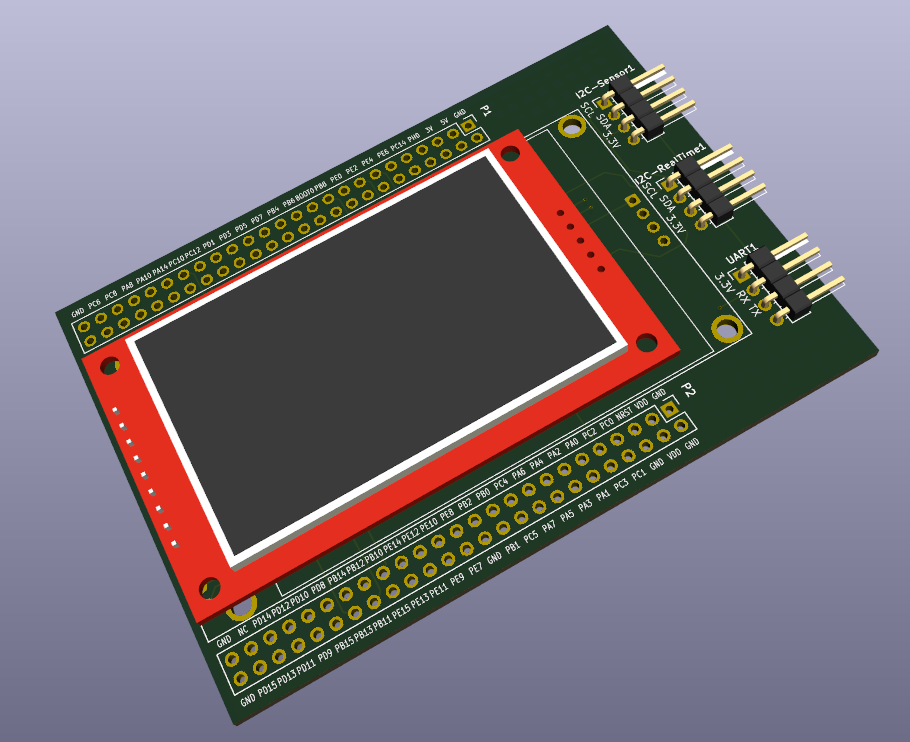

# stm32f407_tft_2.4inch_hat

KiCad project: a **plug-on HAT** for the **STM32F407 Discovery**.

Schematic and PCB only — no firmware in this repo.

## Board preview

### Assembled (real PCB + 2.4" LCD)

### KiCad 3D

Renders and photos live under `doc/` (`PCB.jpg`, `PCB_3D.png`).

## Goal

One board you can solder and plug onto the Discovery:

| Block | On the HAT |
|--------|------------|
| SPI display | 2.4" ILI9341: SCK, MOSI, MISO, CS, D/C, RST, LED |
| I2C | Shared bus, pull-ups, extra connector (Grove / 2.54" / Qwiic) for sensors (e.g. HDC1080) |
| USART A | Debug console header (USB–UART) |
| USART B | ESP32 TX/RX (plus RST, BOOT) — **unstuffed** on first spin is fine |
| Power | 3.3 V / GND from Discovery; ESP32 uses a **5 V → 3.3 V LDO** on the HAT |

## Net names (schematic = PCB)

| Use on schematic | PCB net | Notes |
|------------------|---------|--------|
| `GND` | `/GND` | |
| `3V` | `/3V` | 3.3 V on 1×4 headers |
| `5V` | `/5V` | Discovery 5 V |
| `VDD` | `/VDD` | Discovery 3.3 V pins (tie to `3V` on the schematic if one rail) |
| `DBG_UART2_TX`, `DBG_UART2_RX` | same | USART2 on **PA2 / PA3** (not USART1) |
| `I2C2_SCL`, `I2C2_SDA` | same | **PB10 / PB11** — not `I2C_SCL` / `I2C_SDA` |
| `LCD_*` | same | Display, touch, SD, SPI2 (see signal table below) |

### HAT connectors (PCB)

- **`DBG_UART1`** (1×4): 1 `3V`, 2 `DBG_UART2_RX`, 3 `DBG_UART2_TX`, 4 `GND`
- **`I2C-Sensor1`** / **`I2C-RealTime1`** (1×4): 1 `I2C2_SCL`, 2 `I2C2_SDA`, 3 `3V`, 4 `GND`

### HAT signal pins (schematic labels)

| Function | Connector | Pad | MCU | Net |
|----------|-----------|-----|-----|-----|
| USART2 debug | P2 | 13 | PA2 | `DBG_UART2_TX` |
| USART2 debug | P2 | 14 | PA3 | `DBG_UART2_RX` |
| I2C2 sensor bus | P2 | 33 | PB10 | `I2C2_SCL` |
| I2C2 sensor bus | P2 | 36 | PB11 | `I2C2_SDA` |
| SPI2 display | P2 | 38 | PB13 | `LCD_SCK` |
| SPI2 display | P2 | 40 | PB15 | `LCD_MOSI` |
| SPI2 display | P2 | 9 | PC2 | `LCD_MISO` |
| LCD control | P2 | 41 | PD10 | `LCD_RESET` |
| LCD control | P2 | 42 | PD9 | `LCD_DC` |
| LCD chip select | P1 | 19 | PB9 | `LCD_CS` |
| SPI3 SD / touch (shared CLK/MOSI/MISO) | P1 | 38 | PC10 | `LCD_SD_CLK` |
| SPI3 SD / touch | P1 | 37 | PC11 | `LCD_SD_MISO` |
| SPI3 SD / touch | P1 | 36 | PC12 | `LCD_SD_MOSI` |
| Touch / SD chip selects | P1 | 15 | PE3 | `LCD_T_CS` |
| Touch / SD chip selects | P1 | 14 | PE4 | `LCD_SD_CS` |
| Touch IRQ | P1 | 12 | PE5 | `LCD_T_IRQ` |

On the ILI9341 module, touch and SD share SPI lines; the schematic uses `LCD_SD_*` / `LCD_T_*` aliases on the same nets where noted in KiCad.

## Files

| File | Role |
|------|------|
| `stm32f407_tft_2.4inch_hat.kicad_pro` | Project |
| `stm32f407_tft_2.4inch_hat.kicad_sch` | Schematic |
| `stm32f407_tft_2.4inch_hat.kicad_pcb` | Board |
| `stm32f407_tft_2.7inch_hat_gerber_v1/` | Gerber release + `schematic_v1.pdf` |
| `doc/PCB.jpg` | Assembled HAT with 2.4" LCD (see preview above) |
| `doc/PCB_3D.png` | KiCad 3D board render (see preview above) |

